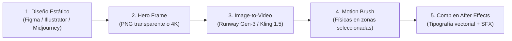

# 🎬 Guía Maestra de Motion Graphics con Inteligencia Artificial

> Por Sangar AI Library — De la idea abstracta a animaciones profesionales con coherencia visual.

---

## 1. El Gran Error del Principiante: Text-to-Video vs Image-to-Video

La mayoría de usuarios que intentan crear motion graphics con IA comienzan escribiendo un prompt de texto esperando que el modelo dibuje su logotipo exacto y lo anime a la perfección en un solo paso. 

**La realidad técnica:** Los modelos de difusión de vídeo actuales (Runway Gen-3, Kling, Sora) son excepcionales interpretando *físicas y luz*, pero son deficientes recreando marcas registradas o tipografías nítidas desde cero.

### La Regla de Oro del Motion Designer:
> **Siempre separa el diseño estático del movimiento.**

---

## 2. Los 12 Principios Clásicos de la Animación adaptados a la IA

Para que una animación no parezca un "morphing gelatinoso", debes usar los términos con los que los modelos fueron entrenados:

### 1. Anticipación (Anticipation)
- **Concepto:** Antes de saltar hacia adelante, el objeto se contrae hacia atrás.
- **En tu prompt:** `subtle backward recoil and anticipation before rapid kinetic forward thrust`.

### 2. Rebote & Amortiguación (Overshoot & Elastic Settle)
- **Concepto:** Un objeto que entra a gran velocidad supera su punto de reposo antes de estabilizarse.
- **En tu prompt:** `snappy entrance with elastic overshoot bounce settling smoothly into center composition`.

### 3. Aceleración y Desaceleración (Ease In & Ease Out)
- **Concepto:** El movimiento natural nunca tiene velocidad lineal constante.
- **En tu prompt:** `dramatic cubic-bezier ease-in with cushioned deceleration ease-out`.

### 4. Trayectorias en Arco (Arcs)
- **Concepto:** Las cosas se mueven en curvas naturales, no en líneas rectas rígidas.
- **En tu prompt:** `sweeping parabolic arced trajectory with smooth orbital momentum`.

### 5. Acción Secundaria (Secondary Action)
- **Concepto:** Un elemento principal se mueve, y otros detalles (chispas, partículas, tela) reaccionan a ese movimiento.
- **En tu prompt:** `secondary particles and micro-droplets dispersing in the air following the main motion path`.

---

## 3. Diccionario de Movimientos de Cámara Cinemática

A los modelos les cuesta entender "haz un zoom chulo". En su lugar, usa el vocabulario de cinematografía profesional:

| Movimiento | Prompt en Inglés | Efecto Visual |
|---|---|---|
| **Slow Dolly In** | `cinematic slow dolly-in push towards subject` | Inmersión, sensación de aproximación dramática. |
| **Crash Zoom** | `rapid crash zoom punch-in with instant snap focus` | Impacto de alta energía, ideal para trailers o beats de música. |
| **Órbita 360°** | `continuous 360-degree orbital camera sweep` | Muestra el volumen 3D y los reflejos de luz de un producto. |
| **Plano Cenital** | `overhead top-down flat-lay view with subtle rotation` | Estilo póster suizo, interfaces o layouts de diseño. |
| **Rack Focus** | `shallow depth of field with smooth rack focus from foreground to subject` | Desenfoque cinematográfico cremoso (bokeh) que guía la mirada. |
| **Whip Pan** | `dynamic whip pan blur transition snapping onto the next element` | Transición ultrarrápida perfecta para cambiar de escena. |

---

## 4. La Física de los Materiales en el Prompt

Para lograr acabados modernos (Dark Luxury, Liquid Chrome, Hologramas), describe cómo la luz interactúa con el material:

- **Liquid Chrome / Mercurio:** `ultra-reflective liquid chrome, high-contrast HDR environment reflection, fluid surface tension caustics`.
- **Glassmorphism / Cristal:** `frosted translucent acrylic glass, internal light refraction, spectral chromatic dispersion, rainbow prism caustics`.
- **Obsidiana y Oro:** `matte black volcanic obsidian stone, brushed 24k gold inlay, crisp razor-sharp specular rim light`.
- **Holográfico Sci-Fi:** `semitransparent volumetric HUD graphics, cyan laser scanlines, floating luminous optical particles`.

---

## 5. El Flujo de Postproducción

1. **Escala y Limpieza:** Pasa el clip por **Topaz Video AI** si necesitas 4K a 60fps con nitidez cristalina.
2. **Máscaras y Compositing:** En After Effects, coloca el logotipo vectorial original encima del vídeo generado para garantizar que los bordes de la marca sean 100% nítidos y no se distorsionen.
3. **Sound Design:** El 50% de la magia de un buen motion graphic es el sonido. Añade *whooshes*, *risers*, *sub-bass drops* y *snaps* mecánicos en cada golpe de animación.
